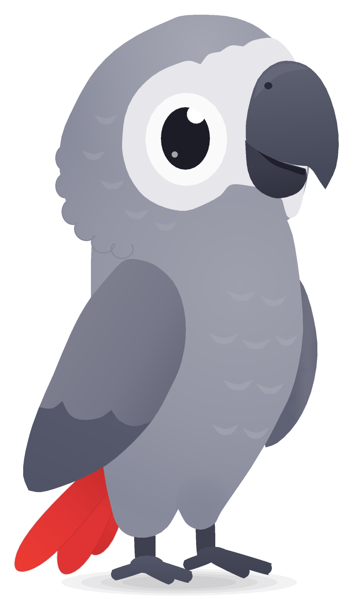

# COCO_ANIMATION_SYSTEM

Coco, the African grey parrot of the English-learning travel app: one master character, one
Rev2D rig, a growing animation library, exports for the web and a tiny player
(`coco.play("happy")`).



## Layout

```
character/        master/ (palette, landmarks, references, renders) · parts/ (layered art) · expressions/
accessories/      education/ · travel/ · clothing/ · rewards/            props as separate rig parts
animations/       idle/ · emotions/ · communication/ · education/ · travel/ · rewards/ · reactions/
rev2d/            models/coco.r2d.json (generated) · rigs/ (skeleton, controls) · source/ (build, qc, export)
exports/          png_sequences/ · spritesheets/ · gifs/ · spine/
previews/         contact_sheets/
documentation/    implementation_plan.md · character_specification.md · animation_catalog.md · integration_guide.md
```

Sources are TypeScript; the model is generated. Never hand-edit `rev2d/models/coco.r2d.json`.

## Build

Requirements: Node 22+ and a checkout of [Rev2D](https://github.com/RevStudio/Rev2D) with its
dependencies installed, next to this repository (`../Rev2D`) or anywhere with `REV2D_HOME` set.

```bash
git clone https://github.com/RevStudio/Rev2D.git ../Rev2D && (cd ../Rev2D && npm ci --ignore-scripts)
```

```bash
cd COCO_ANIMATION_SYSTEM && npm run build && npm run qc
```

`build` assembles the model with Rev2D's edit ops and refuses to write it with validation errors;
`qc` renders the evidence images (master comparison, layers, and later sweeps and contact sheets).

The Rev2D MCP server can inspect the model too (`claude mcp add rev2d -- node <Rev2D>/bin/rev2d.js mcp`,
then `rev2d_validate`, `rev2d_render`, `rev2d_sheet`, `rev2d_inspect`, `rev2d_analyze`).

## Progress report

| Phase | Scope | Status | Evidence |
| --- | --- | --- | --- |
| 1 | Inspection, source-art assessment, master spec, layered vector master | ✅ done | `documentation/character_specification.md`, `character/master/coco_master_compare.png`, `character/parts/coco_layers.png` |
| 2 | Master rig: parameters, bindings, physics | ✅ done | `documentation/rig_reference.md`, `previews/rig/*.png` |
| 3 | Expressions + idle animations | ✅ done | `character/expressions/coco_expressions.png`, `documentation/animation_catalog.md`, `previews/contact_sheets/idle/`, `exports/gifs/` |
| 4 | Communication + education | ✅ done | `previews/review/communication_*.png`, `previews/review/education_*.png`, catalogue |
| 5 | Emotions, travel, rewards, reactions | ✅ done | `previews/review/*.png`, catalogue (90 animations, all verified) |
| 6 | Accessories | ✅ done (47 accessories, effects and scene props) | `accessories/`, `character/expressions/marks.ts` |
| 7 | Exports + web player + app integration | ⏳ (needs the app repository) | |
| 8 | Scenario tests + final catalogue | ⏳ | |

### Phase 1 notes

- The supplied images cannot give a clean, isolated, high-resolution Coco (largest clean figure
  190 × 322 px JPEG; the white face patch mattes out on the white sheet; atlas sprites are ≈ 100 px).
  Coco was therefore **redrawn as a layered vector master** traced from the neutral pose with
  colours sampled from it: 30 parts, 19 bones, 4 warps, validated by Rev2D with 0 errors and 0 warnings.
- Rev2D's single-illustration avatar builder was evaluated and **not used**: it targets front-facing
  human busts and cannot invent the hidden parts (far wing, body under the wing).

### Phase 2 notes

- **33 parameters** (head turn / pitch / tilt, eye open / smile / wide / gaze, brow, beak open / form,
  blush, breath, body turn / lean / squash / position, shadow, both wings raise / spread / curl, tail
  swing / lift / fan, feet, flight tuck), **21 bones, 4 warps, 63 bindings, 1 physics group**.
  Validated by Rev2D: 0 errors, 0 warnings. The full table is generated into
  `documentation/rig_reference.md` on every build.
- Verified with sweep sheets (`previews/rig/`), not just the JSON:
  `grid_head_turn` (pseudo-3D turn; the face patch is clipped to the head so it never pokes out),
  `grid_eye` (blink "◡", happy "∩", squint "◠"), `grid_beak` (open beak with tongue, smile/frown),
  `grid_brow`, `grid_wing_near` / `grid_wing_far` (fold, point, cover face, cheer, spread fingers),
  and one overview per group.
- Numbers (`rev2d_inspect`): the rigid beak stays on the turning face within **0.35 px** across the
  whole AngleX × AngleY range (Rev2D `follow` on a 5 × 5 turn grid); the feet stay exactly planted
  under breathing, lean and body turn.
- Deferred to later phases: sitting pose, head-feather ruffle physics, tears / sweat (effects,
  Phase 5), accessories (Phase 6).

### Phase 3 notes

- **21 expressions** as parameter presets of the one rig (`character/expressions/expressions.ts`):
  neutral, happy, joyful, excited, proud, curious, confused, surprised, worried, sad, disappointed,
  embarrassed, playful (wink), reassuring, mischievous, determined, thinking, suspicious, listening,
  sleepy, asleep.
- **9 idle animations**: breathe, blink (single + double), look around (the eye leads the head),
  curious head tilt, relaxed sway (the tail follows through physics), feather ruffle, sleep, wake up
  (flutter, stretch, yawn, settle) and `idle_main`, the composed 8 s loop the app plays by default.
- Every clip has a contact sheet, a GIF preview and a Rev2D `analyze` report; `npm run qc -- anims`
  checks loop seams, physics clamping, canvas overflow and that one-shots start and end at rest, and
  writes `documentation/animation_catalog.md`. All 9 pass.
- Found and fixed by the QC: Rev2D holds a track's first key before it, so one-shot tracks now get
  an explicit rest key at t = 0 (the wake-up showed its stretch pose from the start).

### Phase 4 notes

- **Accessory framework** (`accessories/lib.ts`): every prop is a separate set of parts on its own
  bone, hidden by default and shown by its `Acc*` parameter. Art is drawn in world coordinates of the
  pose it is held in; the build poses the rig there and maps it onto the hand bone, so the prop lands
  exactly in the hand and then follows it. Head-worn items can use Rev2D `follow` instead.
- **Education props**: book (with the reference's globe emblem), dictionary, pointer, chalk, pencil,
  vocabulary card, notepad, blackboard on an easel with "Aa" that writes itself stroke by stroke
  (`AccBoardText`).
- **Expression marks** (`character/expressions/marks.ts`): "?", alert lines, light bulb, thinking
  dots (lit one by one), sparkles, "Zzz"; they pop in as their `Fx*` parameter rises.
- **18 communication clips**: talk (normal / soft / excited), listen, think, thinking dots, wait,
  explain, nod, shake head, ask (with "?"), idea (light bulb), greet (waves with the far wing like the
  reference), goodbye, point right / left / up (direct attention to UI elements), encourage,
  introduce. **10 education clips**: read book, teach, hold card, write, point at the board, explain
  grammar, pronounce ("ee" / "oo" / "ah" shapes), present a new word, correct an answer, celebrate a
  correct answer. 38 animations in total, all passing the automatic QC.

### Phases 5–6 notes

- **52 more clips**: 14 emotions (happy, excited, proud, curious, confused, surprised, worried,
  disappointed, embarrassed, playful, reassuring, mischievous, sad, love), 16 travel (backpack,
  passport, map, suitcase, photo with flash, binoculars, boarding pass, explore, raincoat, compass,
  take off, fly, land, fly in, fly out, new landmark), 11 rewards (jump, fly excited, celebrate with
  confetti and stars, trophy, medal, crown, heart, confetti, gift, streak, level up) and 11 reactions
  (startled, suspicious, hide, peek, lose balance, dizzy, fall asleep, disappointed, dramatic
  surprise, dance, offline). **90 animations in total, 90 verified** by the automatic QC.
- **47 accessories**: education (8), travel (9: backpack, suitcase, passport, map, camera,
  binoculars, boarding pass, compass, umbrella), clothing (8: explorer hat, pilot cap, graduation
  cap, sunglasses, headphones, scarf, raincoat + hood), rewards (6 props + stars, hearts, confetti,
  glow), 11 expression marks and a wall for peeking. Hats, the crown, headphones and sunglasses ride
  the turning head through Rev2D `follow` (residual ≤ 0.22 px); the raincoat and hood deform inside
  the body and head warps.
- Tuned with `analyze`: the tail pendulum's inputs and output scale were set so even the fastest
  clip (flying in from off-screen) never pins the tail at its limit.

See `documentation/implementation_plan.md` for the architecture, the rig controls, the animation
naming convention, the app presets and the export/integration evaluation.
