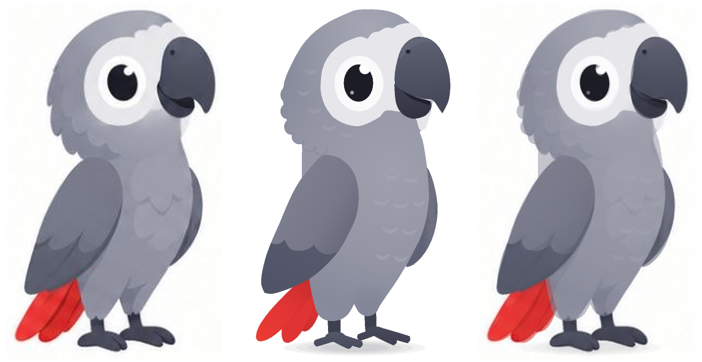
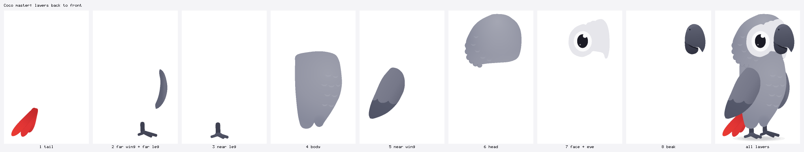

# Coco — master character specification

Coco is the mascot of the English-learning travel app: an **African grey parrot** who teaches,
reacts, explores and celebrates with the learner. This document is the contract every drawing,
rig, animation and accessory must follow, so there is exactly **one** Coco.

The master is not a picture but source code: the parts are defined in `character/parts/*.ts`, the
colours in `character/master/palette.ts`, the anchor points in `character/master/landmarks.ts`.
`npm run build` turns them into the Rev2D model `rev2d/models/coco.r2d.json`; `npm run qc` renders
the images referenced below.

| File | What it shows |
| --- | --- |
| `character/master/coco_master.png` | the master, rest pose, transparent background (430 × 680 px crop of the canvas) |
| `character/master/coco_master@2x.png` | the same at 2× |
| `character/master/coco_master_compare.png` | reference ▸ vector master ▸ onion-skin overlay of both |
| `character/parts/coco_layers.png` | the layers back to front (exploded view) |
| `character/master/reference/` | the three supplied reference images, unchanged |
| `character/master/reference_analysis/` | the reference placed in canvas space, the tracing grid, the extraction test |

## 1. Identity

- **Species:** African grey parrot (*Psittacus erithacus*): grey body, bare white face patch around
  the eye, black beak, signature **red tail**.
- **Personality:** friendly, curious, intelligent, encouraging; a patient teacher and a cheerful
  travel companion. Never sarcastic or scary; even "suspicious" or "mischievous" stays playful.
- **Pronoun in app copy:** "it" (as in the product brief: "Coco introduces itself").

## 2. Canonical view and conventions

- **Three-quarter view facing screen-right.** Every reference pose uses it; it is Coco's identity
  view. Only **one eye** is visible (the near eye), the beak points right.
- **Facing left** is the same artwork **mirrored** (the frontend flips the sprite or the export is
  mirrored). Never redraw a separate left-facing Coco.
- **Sides** follow Rev2D / Live2D naming: `L` / `R` are Coco's own left / right. Coco faces right,
  so its **right** side faces the viewer: `wingR`, `legR`, `footR` and the visible eye are the near
  ones; `wingL`, `legL`, `footL` are on the far side (drawn behind, slightly darker).
- **Canvas:** 1024 × 1024 px, transparent. Setup space = canvas pixels, origin top-left, +y down,
  angles in degrees clockwise (Rev2D conventions). The ground line is **y = 893**; the root bone (the
  squash pivot) sits at **(512, 893)**. Every animation shares this canvas and anchor, so sprites from
  different animations line up without offsets.

## 3. Proportions (rest pose, canvas px)

| Measure | Value | Notes |
| --- | --- | --- |
| Total height | 636 (y 257 → 893) | crown to the soles |
| Head height | ≈ 242 (y 258 → ≈ 500) | **≈ 38 % of the height**: big, friendly head |
| Head width | 282 (x 388 → 670); 313 with the beak | |
| Body | 238 wide (x 423 → 661), y 448 → 843 | pear-shaped torso, widest at the chest |
| Eye | 55 × 70, centre (529, 396) | taller than wide; centre at ½ of the head width, 57 % down the head |
| Eye ring | 92 × 104, centre (530, 397) | ring ≈ 16–18 px wide around the eye |
| Face patch | x 458 → 666, y 284 → 484 | wraps behind the beak to the head's front edge |
| Beak | 104 × 153 (x 597 → 701, y 309 → 462) | hook tip at (686, 453) |
| Near wing (folded) | 182 × 260 (x 347 → 529, y 532 → 792) | tip at (353, 790) |
| Tail | 3 feathers, 89–137 px long, 38–42 px wide | tips at y 862–883, fanning down-left |
| Legs / feet | legs 21–23 px wide; feet x 447 → 625 | near foot lower (closer to the viewer) |

Rules of thumb: the eye is about **¼ of the head width**; the beak is as tall as the eye ring and
juts ≈ 30 px past the head; the tail tips reach the ground line; the feet are short and stocky.

## 4. Colour palette

Defined once in `character/master/palette.ts`. Sampled from `reference/coco_reference_poses_light.jpg`
(neutral pose, placed in canvas space) at the noted canvas points; values are medians of 3–5 samples.

| Token | Hex | Role | Reference sample |
| --- | --- | --- | --- |
| `headLight` | `#a8aab6` | crown light | (500–560, 275–300): `#a4a6b4` |
| `headBase` / `headDark` | `#9a9caa` / `#8c8e9d` | head, back of the head | (410, 400): `#90919e` |
| `bodyLight` | `#9ea0ad` | chest centre | (600, 600): `#9a9ca9` |
| `bodyBase` / `bodyDark` | `#9496a5` / `#878a9b` | flanks, belly | (560, 760): `#8f90a0` |
| `bodyShadow` | `#7e8193` | far-thigh shade | (540, 800): `#7f8292` |
| `chestScallop` | `#a7a9b6` | feather edges (chest, back of the head) | lighter scallops on the chest |
| `facePatch` | `#e6e6eb` | bare face patch | (468, 400): `#e6e5ea` |
| `eyeRing` | `#fafafb` | ring around the eye | (492–566, 395): `#fafafa` |
| `eye` | `#1c1c26` | the eye | (529, 396): `#1c1c26` |
| `eyeHighlight` | `#ffffff` | highlights | (541, 372): `#f8f9fd` |
| `beakTop` → `beakBottom` | `#5f6273` → `#464959` | upper mandible, light to dark | x 640: `#595c6d` (y 320) → `#494c5b` (y 400) |
| `beakLower` / `beakLowerDark` | `#3b3d4d` / `#30323f` | lower mandible | (640, 450): `#3b3c4e` |
| `mouthLine` | `#1f202b` | smile line | (640, 434): `#21222f` |
| `nostril` | `#272a39` | nostril | (622, 338): `#282b3b` |
| `mouthInside` / `tongue` | `#5c2531` / `#d8737e` | open beak (from the atlas' open-beak heads) | |
| `covertLight` → `covertEdge` | `#7f8191` → `#6a6c7d` | wing coverts | (470, 600): `#787a8a` |
| `primary` / `primaryDark` | `#5c6072` / `#515466` | flight feathers | (400, 740): `#5c6071` |
| `farWing` / `farWingDark` | `#6e7081` / `#5f6274` | far wing | (668, 650): `#6d707d` |
| `tailLight` / `tail` / `tailDark` | `#ec3b32` / `#e03434` / `#c32a2b` | tail tip → root | (345, 860): `#e9372e`, (425, 830): `#d62d2d` |
| `leg` / `foot` / `footLight` | `#3e4050` / `#474a5a` / `#55586b` | legs, feet | (480, 845): `#3c3e4e`, (500, 885): `#48495b` |
| `blush` / `brow` / `tear` | `#f29aa5` / `#3b3d4d` / `#6db6f2` | expression extras (hidden at rest) | atlas expressions |

Rules: greys are cool (blue-violet), never neutral or warm. Red appears **only** on the tail (and
red accessories). Darkest value = the eye; lightest = eye ring and highlights.

## 5. Face

- **Face patch:** a large white patch around the eye, wrapping forward behind the beak. Its top
  edge is **scalloped**: three small grey feather tips overlap it (at x ≈ 546, 568, 594).
- **Eye ring:** a brighter white ellipse around the eye, ≈ 16–18 px wide.
- **Eye:** one large **solid black** ellipse (no visible iris). **Two highlights**: a big round one
  (r ≈ 10) at the **upper right** (toward the beak) that bites into the eye's edge, and a small one
  (r ≈ 3.5) at the lower left. The highlights stay in place relative to the eye and are clipped by
  it, so they vanish when the eye closes.
- **Beak:** a big hooked **upper mandible** (charcoal, lighter on top, with a soft sheen and a small
  nostril near its top-left), over a darker **lower mandible**; a dark **smile line** curves up
  between them. Coco's resting expression is a gentle smile.
- **Closed eyes** (planned in the rig): blink = a curved dark line (lid down); happy = an upward
  arc "∩", as in the atlas' happy heads.

## 6. Body structure

- **Head:** round, big, lighter crown; the back of the head and the nape are **scalloped** (rounded
  feather lobes along the contour).
- **Torso:** pear-shaped, light chest with soft lighter **feather scallops** in staggered rows,
  slightly darker flanks and belly; two rounded thighs at the bottom (the far one in shade).
- **Near wing:** a folded **teardrop** from the shoulder down to a tip near the tail: lighter
  **coverts** on top ending in **three rounded lobes**, darker **flight feathers** below.
- **Far wing:** a darker crescent along the front of the chest (the rest hides behind the body).
- **Tail:** **three red feathers** fanning down-left from under the wing; the front one brightest.
- **Legs and feet:** short dark legs; stocky feet with three visible rounded toes each (parrots are
  zygodactyl: one back toe points left, two front toes point right).

## 7. Drawing style

- Soft, rounded, handcrafted cartoon: **no outlines** around the character. Shapes are separated by
  value, not by lines; the only thin lines are internal (smile line, nape lobe edges, feather tips).
- **Soft shading** with gentle gradients (light from the top), one value step per form; no hard
  cel shadows, no texture noise.
- **Scallops** are the feather motif (crown/patch border, nape, chest, coverts). Keep them few and
  subtle.
- Curves everywhere: no sharp corners except the beak's hook tip and the coverts' notches.
- Grounding: a soft contact shadow under the feet (part `shadow`, can be hidden by the app).

## 8. Construction (the layers)

Back to front (draw order = `z`). Every part is a **complete** shape — the body continues under
the wing, the tail roots under the body, the head under the face — so moving parts never open
holes. Parents are bones (rigid) or warps (lattice deformation), see `rev2d/rigs/skeleton.ts`.

| z | Part(s) | Hangs from | Notes |
| --- | --- | --- | --- |
| 0 | `shadow` | `root` | 4 stacked translucent ellipses |
| 1–3 | `tailF3`, `tailF2`, `tailF1` | `tailF1..3` bones | one bone per feather: fan + swing |
| 4 | `wingL` | skin `wingL_arm`, `wingL_hand` | far wing |
| 5–8 | `legL`, `footL`, `legR`, `footR` | legs skinned thigh → foot; feet on `root` | feet stay planted |
| 10–12 | `body`, `thighShade`, `chestScallops` | `bodyWarp` | shared feather gradient with the head |
| 14–15 | `wingR`, `wingRCovert` | skin `wingR_arm`, `wingR_hand` | coverts masked by the wing |
| 18–20.6 | `napeLobes`, `head`, `crownLight`, `headScallops` | `headWarp` | |
| 22–25 | `facePatch`, `eyeRing`, `eye`, `eyeHighlight`, `eyeHighlight2` | `faceWarp`; eye parts in `eyeWarp` | eye = 4-segment path (morphable) |
| 26–32 | `mouthInside`, `tongue`, `beakLower`, `mouthLine`, `beakUpper`, `beakSheen`, `nostril` | `beak` / `jaw` bones | the jaw rotates to open the beak |

Accessories are **separate parts on their own bones / warps** (never merged into the body art) and
are hidden by default; see `accessories/`.

## 9. Consistency rules

1. One master. Poses, expressions and accessories are **parameters of the one rig**, never new
   drawings of Coco.
2. Colours only from `palette.ts`; proportions only from `landmarks.ts` / the parts.
3. One visible eye, three-quarter view. Facing left = mirror.
4. The eye is always solid black with the two highlights in the same places.
5. The tail is always red with three feathers; wings are always darker than the body.
6. No outlines, no gradients that change hue, no extra limbs or human hands: wings do the
   gesturing (the wingtip feathers act as "fingers").
7. Every new pose is verified against this sheet (`npm run qc`) before it ships.

## 10. Source artwork assessment

The brief asked whether a clean, isolated, front-facing Coco can be extracted from the supplied
images before rigging. Findings (`character/master/reference_analysis/`):

| Image | Content | Usable as rig source? |
| --- | --- | --- |
| `coco_reference_atlas.webp` (1125 × 750, real alpha) | ~94 sprites: heads, poses, accessories | Clean edges, but **too small**: full-body poses are ≈ 70–140 px wide, heads ≈ 90 px. |
| `coco_reference_poses_light.jpg` (1280 × 1170) | 10 poses on white | Largest neutral pose is **190 × 322 px**, JPEG. Matting fails: the white face patch and eye ring are as light as the background (`extraction_test_white_matte.png`: the patch turns transparent). |
| `coco_reference_poses_dark.jpg` (1280 × 853) | 10 poses on black | The dark beak, eye and wings merge with the background; a different render from the light sheet, so no difference matting. |

All poses are flattened single layers in three-quarter view: the far wing, the body behind the
wing and the tail roots were never drawn. Rev2D's avatar builder cannot invent hidden art, works
best on front-facing human busts ≥ 256 px, and places human landmarks (hair, face, mouth); it does
not fit a full-body parrot with wings, tail and feet.

**Decision:** no reliable raster source exists, so Coco was redrawn as a **layered vector master**,
traced on a coordinate grid from the neutral pose (2 canvas px per reference px) with colours
sampled from it. Every part is complete and editable, resolution-independent, and natively
animatable in Rev2D (path morphs, masks, gradients).

**Optional artwork that would raise fidelity further** (not blocking):

1. A high-resolution layered master of the neutral pose (PSD/SVG, ≥ 1500 px tall) with the parts of
   §8 separated — for a painted texture pass on top of the vector rig.
2. A spread-wing turnaround (near and far wing open, from the front) — the reference shows open
   wings only small and partly covered.
3. Accessory designs at higher resolution (the atlas versions are ≈ 50 px icons; they are being
   redrawn as vectors in the palette).
